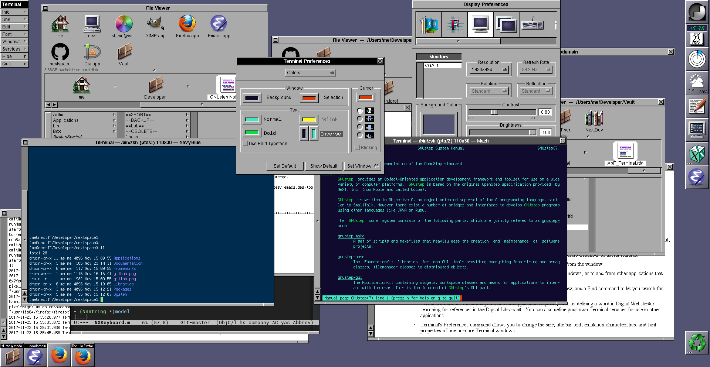

# ArchSTEP

ArchSTEP is a desktop environment that brings the [NeXTSTEP](https://en.wikipedia.org/wiki/NeXTSTEP) look and feel to **Arch Linux** — and asks what NeXTSTEP would look like if NeXT had kept shipping until 2026. It is a fork of [NEXTSPACE](https://github.com/trunkmaster/nextspace) developed according to the ["OpenStep User Interface Guidelines"](http://www.gnustep.org/resources/documentation/OpenStepUserInterfaceGuidelines.pdf).

> An explanation of the NeXTSTEP / NextStep naming convention is discussed in further detail [here](Documentation/OpenStep%20Confusion.md).

Two commitments define the fork (see [docs/VISION.md](docs/VISION.md)):

1. **Arch Linux only.** One distro, one toolchain, one package manager. Everything that existed upstream to support RedHat/Debian-family distributions has been deleted, not maintained.
2. **NeXTSTEP, re-envisioned for 2026.** Quiet, fast, spatially trustworthy, legible. Modern capability (HiDPI, real compositing, accessibility, current hardware) without modern spectacle — no transition animations, no blur, no engagement mechanics. The restraint is the identity.

The upstream introduction to the core applications (Login, Workspace, Preferences, Terminal, …) is [here](Applications.md). To put a third-party app (Signal, other Electron/X11 apps) in the Dock, see [Docking Third-Party Apps](Documentation/Docking%20Third-Party%20Apps.md).

## Status

Early port. The current milestone plan is in [docs/ROADMAP-v1.md](docs/ROADMAP-v1.md): building the full stack on current Arch, booting it, then vendoring the GNUstep stack in-repo at latest upstream, then PKGBUILDs and AUR packages.

## Not planned

* Support for any distribution other than Arch Linux.
* GNOME, KDE, macOS rivalry in terms of visual effects and fashion-driven design.
* Implementing a macOS-like desktop paradigm. There is another good place for this — see [Étoilé](http://etoileos.com).

## Installing

Until PKGBUILDs land (roadmap M5), the only path is building from source with the scripts in [Packaging/Sources](Packaging/Sources/README.md). Test in a VM: Login.app replaces your display manager.

## For developers

Upstream's development notes live on the [NEXTSPACE Wiki](https://github.com/trunkmaster/nextspace/wiki); they largely still apply to the code. ArchSTEP-specific direction is in [docs/](docs/).
